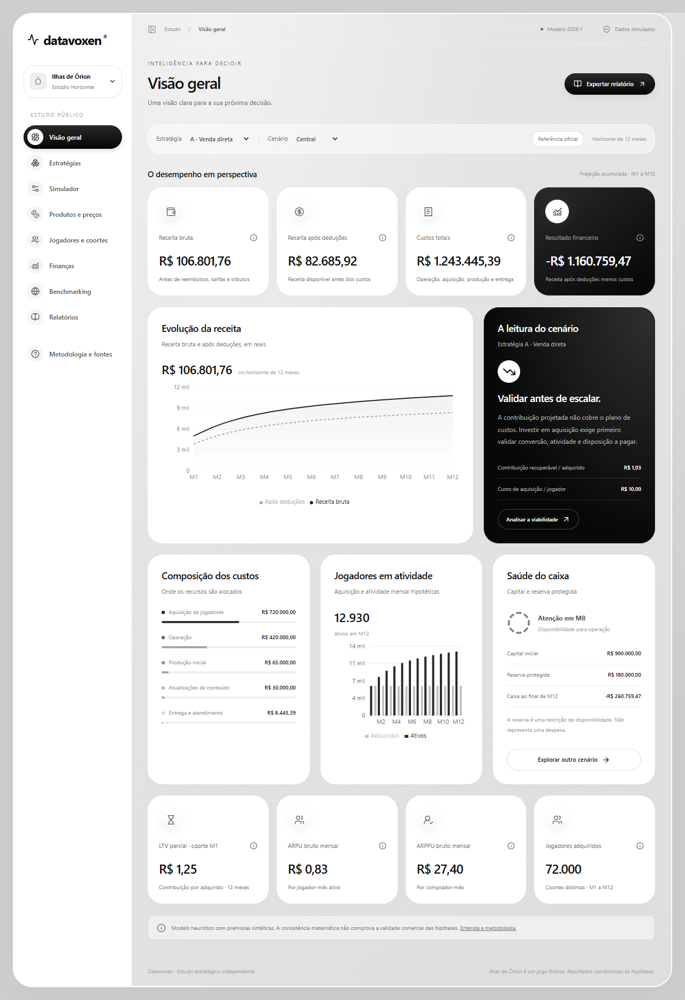
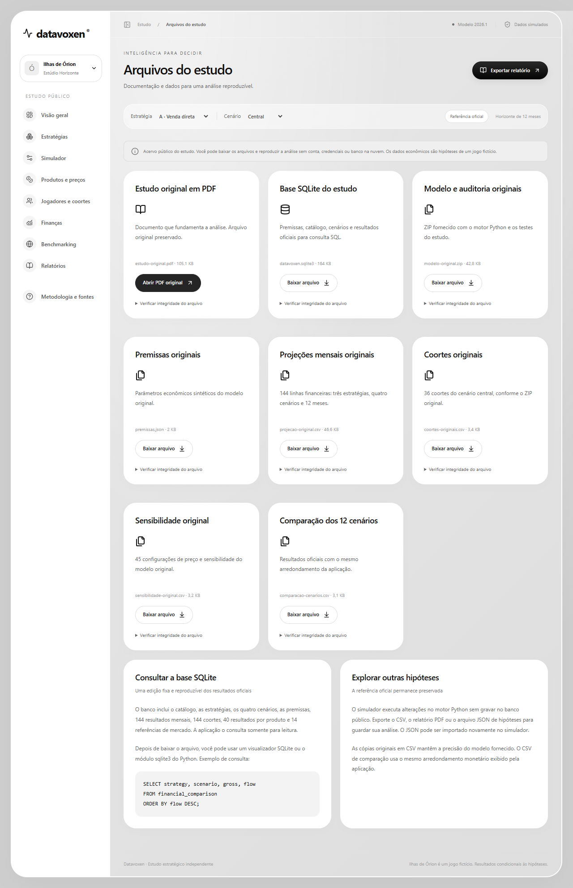
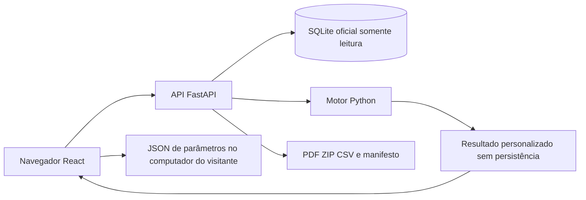

# Datavoxen

O Datavoxen é uma plataforma de Business Intelligence e simulação financeira para investigar a sustentabilidade da monetização de jogos gratuitos. O estudo acompanha o **Estúdio Horizonte** e o jogo mobile **Ilhas de Órion**, ambos fictícios, e compara três estratégias comerciais em quatro cenários de 12 meses. A aplicação transforma um modelo Python e um relatório de pesquisa em uma interface navegável, com resultados, premissas e documentos disponíveis para conferência.

**Os parâmetros econômicos são hipóteses sintéticas, e não vendas observadas.** O propósito é explicitar como escolhas de produto, aquisição e custos afetam a decisão de investir.



## Origem e motivação

Jogos gratuitos precisam financiar desenvolvimento e operação sem depender de uma cobrança inicial. Uma oferta pode aumentar o faturamento e, ao mesmo tempo, piorar o resultado por exigir mais conteúdo, produção e aquisição de jogadores. A pergunta deste estudo é quais estratégias mereceriam um teste comercial antes de ampliar investimentos.

O projeto foi desenvolvido de forma independente, sem informações internas de empresas reais. A investigação conecta pesquisa de mercado, hipóteses de diferenciação, modelagem de escolha, projeção de coortes e fluxo de caixa. O software permite consultar o estudo fechado e experimentar mudanças sem alterar sua referência oficial.

O [relatório original em PDF](docs/references/Datavoxen_Relatorio_Encerrado_2026.pdf) apresenta a fundamentação; o [ZIP original](docs/references/Modelo_Datavoxen.zip) contém o núcleo numérico; o [SQLite](backend/data/datavoxen.sqlite3) distribui as execuções oficiais. A hierarquia dessas fontes e suas diferenças estão registradas na [auditoria inicial](docs/audit/initial-findings.md).

## Origem e natureza dos dados

| Classificação | Dados utilizados | Origem |
|---|---|---|
| Evidências públicas | Pesquisa Game Brasil, gamescom latam, StatCounter e meios de pagamento | Publicações externas |
| Benchmarking | 14 ofertas históricas de sete jogos | Lojas e canais comerciais documentados |
| Hipóteses sintéticas | CAC, preços candidatos, atratividade, atividade, custos e deduções | Premissas do estudo fictício |
| Resultados calculados | Receita, contribuição, coortes, LTV, caixa e cenários | Motor financeiro Python |
| Evidência operacional real | Conversão, retenção e disposição a pagar do jogo fictício | Não disponível |

Os dados públicos contextualizam o mercado brasileiro e ajudam a formular hipóteses comerciais. As premissas sintéticas permitem construir uma simulação reproduzível. Seus resultados são consequências matemáticas dessas premissas, sem representar vendas reais. Conversão, retenção e disposição a pagar exigem pesquisa ou experimento com o produto.

## Contexto do mercado brasileiro

O estudo usa dados públicos para delimitar o contexto, sem convertê-los automaticamente em demanda para um produto inexistente.

| Evidência documentada | Fonte e período | Interpretação para o projeto |
|---|---|---|
| 75,3% dos pesquisados consomem jogos digitais | Pesquisa Game Brasil 2026, divulgada pela gamescom latam | Indica alcance do hábito; não mede conversão pagante |
| Mobile é a plataforma preferida de 44,1% | Mesma divulgação de 2026 | Justifica estudar experiências móveis; não representa participação de receita |
| Amostra de 7.115 pessoas entre 16 e 55 anos | Divulgação metodológica da PGB 2026 | Delimita a população pesquisada; não é uma amostra dos jogadores de Ilhas de Órion |
| Android: 78,78% do tráfego mobile no Brasil | StatCounter, setembro de 2026, conforme PDF | Apoia a prioridade técnica Android; não mede instalações, renda ou compradores de jogos |

Os números da PGB e o desenho da amostra são apresentados na [publicação da gamescom latam](https://latam.gamescom.global/pt/mercado-de-games-na-america-latina-quem-sao-os-jogadores-e-como-conectar-marcas-a-esse-publico/). O relatório preserva a consulta histórica ao [StatCounter](https://gs.statcounter.com/os-market-share/mobile/brazil); a série combinada Mobile & Tablet, com 78,83%, tem outro denominador e não deve substituir a série mobile.

O Pix é considerado no planejamento de pagamento por sua relevância no Brasil, com referência ao [Banco Central](https://www.bcb.gov.br/estabilidadefinanceira/pix). Não foi documentada uma taxa de adoção específica entre os futuros jogadores. Condições de pagamento dependem do canal de distribuição. Também não há medição própria de renda ou disposição a pagar: a sensibilidade a preços exige pesquisa segmentada. Participação de Android não permite inferir poder de compra.

A concorrência gratuita torna a atenção disputada e cria referências de oferta. Esses dados contextualizam a oportunidade; não provam que haverá compradores para o jogo fictício. A auditoria não teve acesso aos microdados ou ao questionário integral da PGB. Consulte a [proveniência das fontes](docs/methodology/sources.md).

## Benchmarking competitivo

Foram selecionados seis jogos com presença mobile e uma referência complementar de PC para observar moedas virtuais, passes e recorrência. As ofertas abaixo são os **14 registros históricos preservados no banco**, consultados em **29/10/2026**. Não foram reconfirmadas como preços atuais.

| Jogo | Modelo comercial observado | Ofertas registradas em reais | Canal | Limitação |
|---|---|---|---|---|
| Free Fire | Moedas e ofertas recorrentes | 100 diamantes: 4,90; 520: 27,90 | App Store Brasil | Oferta iOS; não equivale a cosmético |
| Call of Duty: Mobile | Moedas, itens e passe | 460 CP: 19,49; 960 CP: 38,99 | Loja web oficial | Condições promocionais do canal |
| PUBG Mobile | Moedas, passe e assinatura | 300 UC: 29,90; 600 UC: 59,90 | App Store Brasil | Valores iOS, sem equivalência Android |
| Fortnite | Moedas, passe e clube | 800 V-Bucks: 31,99; 2.400: 79,00 | App Store Brasil | Recargas e clube têm conteúdos distintos |
| Brawl Stars | Gemas e passe de temporada | 30 gemas: 12,50; 80: 29,90 | App Store Brasil | Recarga não representa o passe completo |
| Clash Royale | Gemas e passes | Punhado: 5,90; bolsa: 29,90 | App Store Brasil | Quantidade e canal limitam comparação |
| VALORANT | Moeda e cosméticos | 475 VP: 18,90; 1.000: 38,90 | Codashop Brasil | Referência complementar de PC |

As fontes individuais estão na [documentação de fontes](docs/methodology/sources.md) e no módulo de benchmarking. O PDF também descreve assinaturas e passes, mas esses exemplos não se confundem com as 14 recargas da base. Moedas, assinaturas, passes e itens individuais têm conteúdos e prazos diferentes. O benchmarking ajudou a formular uma escada de preços para testar, sem validar a disposição a pagar pelo novo jogo.

## Problema de negócio e hipóteses

Ilhas de Órion é concebido como uma aventura cooperativa de sessões curtas, com personalização social. A progressão fundamental permanece gratuita e as compras propostas não concedem vantagem competitiva. O desafio é financiar essa experiência com contribuição suficiente após deduções, custos variáveis, operação e aquisição.

Três hipóteses orientam a pesquisa. A visibilidade social dos cosméticos poderia aumentar sua atratividade; coleções coordenadas poderiam gerar contribuição incremental mesmo substituindo itens avulsos; um passe poderia melhorar recorrência e contribuição por coorte sem prejudicar quem joga gratuitamente. Nenhuma dessas hipóteses foi comprovada. Pesquisas de escolha e um piloto com grupos comparáveis seriam necessários para verificá-las.

## Produtos e preços

A escada combina entrada de menor preço, identidade visual, pacote coordenado e ofertas vinculadas a temporadas. Ela procura atender motivações diferentes, mas todos os produtos disputam o orçamento do mesmo jogador.

| Categoria | Entrega e função proposta | Preço central | Alternativas comerciais do PDF | Custo variável por unidade |
|---|---|---:|---:|---:|
| Traje | Identidade visual e expressão social | 24,90 | 21,15 / 28,65 | 2,00 |
| Efeito | Personalização visual de entrada | 14,90 | 12,65 / 17,15 | 1,00 |
| Coleção | Conjunto coordenado que pode substituir itens avulsos | 59,90 | 50,90 / 68,90 | 5,00 |
| Passe | Conteúdo e recompensas da temporada | 34,90 | 29,65 / 40,15 | 3,00 |
| Sazonal | Oferta vinculada a campanha e calendário reais | 39,90 | 33,90 / 45,90 | 4,00 |

Valores em reais. São propostas, sem validação com consumidores. O PDF usa uma grade comercial aproximadamente ±15%; o motor e a API aplicam multiplicadores exatos de preço, portanto alguns centavos diferem. Essa diferença é preservada, sem alterar os cálculos para igualar o texto.

Adicionar uma categoria pode reduzir a participação das anteriores. Uma coleção pode aumentar o valor da cesta e substituir o traje avulso. A análise relevante é a contribuição incremental do portfólio após produzir e atualizar cada oferta.

## Metodologia quantitativa

A hierarquia das fontes é explícita: o **PDF estratégico** apresenta problema, fundamentação, pressupostos e decisões comerciais; o **motor Python auditado** é a referência computacional das fórmulas e dos resultados; o **SQLite** distribui as execuções oficiais geradas por esse motor. Diferenças conhecidas entre explicações do documento e comportamento do código estão registradas em [initial-findings.md](docs/audit/initial-findings.md). Essas descrições divergentes não são tratadas como modelos equivalentes, nem justificam mudar fórmulas para adaptar os resultados ao texto.

Cada mês recebe uma nova coorte. No central, são 6.000 contas adquiridas por mês, com CAC de R$ 10,00. A atividade de cada coorte segue o vetor hipotético `1; 0,30; 0,21; 0,15; 0,11; 0,085; 0,07; 0,06; 0,05; 0,045; 0,04; 0,035`. A base elegível é a soma das contas ativas das coortes presentes naquele mês. Isso é atividade mensal agregada e não retenção D1, D7 ou D30.

O modelo transforma atratividade e preço em pesos relativos de escolha:

```text
fora = 1 − soma das atratividades das cinco categorias
peso_i = (atratividade_i / fora) × engajamento × multiplicador_preço_i^(−elasticidade)
probabilidade_i = peso_i / (1 + soma dos pesos disponíveis)
probabilidade_não_compra = 1 / (1 + soma dos pesos disponíveis)
unidades_i = jogadores ativos no mês × probabilidade_i
```

As atratividades de referência são 0,015, 0,010, 0,005, 0,008 e 0,004; a opção externa é 0,958 e a elasticidade central é 1,25. São parâmetros heurísticos: **não se trata de um logit multinomial empiricamente estimado**. A estrutura representa uma cesta exclusiva por jogador-mês, com unidades esperadas fracionárias, sem compras múltiplas. Adicionar um produto reduz as probabilidades dos anteriores e também a de não compra, mantendo seus pesos. Esse comportamento do código difere de uma passagem explicativa do PDF, registrada na auditoria.

```text
receita bruta = soma(unidades × preço central × multiplicador de preço) × spend
receita líquida = receita bruta × (1 − reembolso) × (1 − plataforma − tributos)
contribuição = receita líquida − custos variáveis
resultado mensal = contribuição − produção − conteúdo − operação − aquisição
caixa final = capital inicial + soma dos resultados mensais
```

Reembolso de 2%, plataforma de 15% e tributos de 6% são hipóteses. Plataforma e tributos incidem sobre a mesma receita após reembolso, resultando em 77,42% da receita bruta como líquida. Não representam uma alíquota universal. O multiplicador legado `spend` afeta receita, sem alterar unidades ou custos variáveis; `init` não é utilizado pelo núcleo original.

CAC é o gasto de aquisição por nova conta. O LTV parcial é a contribuição antes de CAC e custos fixos por adquirido da primeira coorte, observada por 12 meses. Coortes posteriores têm janelas menores. A contribuição recuperável média considera todas as contas adquiridas no horizonte e não é igual ao LTV da primeira coorte.

ARPU usa receita bruta por jogador-mês ativo; ARPPU usa receita bruta por comprador-mês, sem representar compradores anuais únicos. O equilíbrio por aquisição considera contribuição por adquirido menos CAC: se esse saldo é negativo, ampliar aquisição não cobre os custos fixos. A base equivalente de jogadores-mês é outra medida, com orçamento de mídia fixo, e não um plano operacional de escala.

A sensibilidade da interface varia parâmetros isoladamente em ±15%. A matriz de preços original e os exercícios específicos do PDF usam outras grades. Os cálculos mantêm precisão interna e só arredondam saídas monetárias com `ROUND_HALF_UP`; somar linhas já arredondadas pode produzir diferenças de centavos. Consulte as [regras matemáticas](docs/methodology/economic-model.md).

## Cenários e resultados

A estratégia A prioriza venda direta; B prioriza passe; C combina os portfólios. O catálogo efetivo está em `strategy_products`. Produção inicial custa respectivamente R$ 65 mil, R$ 95 mil e R$ 120 mil. Atualizações em M4, M7 e M10 custam R$ 10 mil, R$ 16 mil e R$ 21 mil por atualização. O central inclui operação de R$ 35 mil por mês, capital inicial de R$ 900 mil e reserva de R$ 180 mil.

| Estratégia | Conservador | Central | Otimista | Estresse |
|---|---:|---:|---:|---:|
| A | -R$ 1.236.375,97 | -R$ 1.160.759,47 | -R$ 1.013.098,60 | -R$ 1.235.902,93 |
| B | -R$ 1.302.514,33 | -R$ 1.243.869,19 | -R$ 1.125.164,27 | -R$ 1.292.323,91 |
| C | -R$ 1.304.899,97 | -R$ 1.211.175,43 | -R$ 1.032.954,92 | -R$ 1.314.848,32 |


Os cenários alteram aquisição, CAC, engajamento, gasto e operação conforme as [premissas oficiais](backend/data/premissas.json). Não são intervalos estatísticos de confiança. Mesmo o otimista permanece deficitário nas três estratégias.

| Cenário central, 12 meses | A | B | C |
|---|---:|---:|---:|
| Receita bruta | R$ 106.801,76 | R$ 56.319,71 | R$ 161.848,90 |
| Receita líquida | R$ 82.685,92 | R$ 43.602,72 | R$ 125.303,42 |
| Custos variáveis | R$ 8.445,39 | R$ 4.471,91 | R$ 13.478,85 |
| Custos totais, incluindo aquisição | R$ 1.243.445,39 | R$ 1.287.471,91 | R$ 1.336.478,85 |
| Resultado financeiro | -R$ 1.160.759,47 | -R$ 1.243.869,19 | -R$ 1.211.175,43 |
| Caixa final após capital inicial | -R$ 260.759,47 | -R$ 343.869,19 | -R$ 311.175,43 |


C gera mais faturamento, mas exige R$ 88 mil adicionais de produção e conteúdo frente a A. Sua contribuição incremental após variáveis é de aproximadamente R$ 37,6 mil, insuficiente para compensar esse custo. A obtém o menor déficit central, sem se tornar viável.

O orçamento central de aquisição é de R$ 720 mil anuais. O LTV parcial de contribuição da primeira coorte é de R$ 1,25 em A, R$ 0,66 em B e R$ 1,88 em C, diante de CAC de R$ 10,00. A contribuição recuperável média inclui coortes recentes. Maior receita ou mais contas adquiridas não corrigem essa economia unitária.

## Decisão estratégica e marcos de avaliação

A recomendação é restringir o investimento a pesquisa e piloto, começando pela venda direta por sua menor estrutura de custos. Isso não demonstra superioridade comercial de A; apenas reduz a exposição enquanto as hipóteses são testadas. Não se recomenda escalar mídia paga com as premissas atuais.

Em **M3**, a revisão deve reunir pesquisa segmentada de escolha com incerteza explícita, atividade e retenção reais, CAC medido e projeção de M4 a M6 preservando a reserva de R$ 180 mil. Pagamento e entrega devem funcionar sem falhas relevantes. Ausência de evidência suficiente impede expansão: cabe limitar o protótipo e rever preço, público ou custo.

Em **M6**, a continuidade exige contribuição incremental observada após reembolsos e custos variáveis, recuperação de CAC pelo LTV de contribuição com margem de segurança aprovada e caixa projetado para os seis meses seguintes preservando a reserva. Retenção gratuita e reclamações são métricas de proteção. Se essas condições falharem, cabe reduzir ou suspender a estratégia, sem financiar a decisão apenas pelo cenário otimista. Uma amostra sem poder suficiente gera conclusão inconclusiva, não aprovação automática.

## Limitações e validação futura

**Não é possível comprovar a conversão, a retenção ou a disposição a pagar dos jogadores de um produto fictício sem realizar pesquisa ou experimento real.** Dados públicos contextualizam; parâmetros sintéticos geram projeções; testes computacionais verificam a implementação. Nenhum desses elementos substitui evidência comercial própria.

O modelo não representa múltiplas compras por mês, heterogeneidade individual, sazonalidade observada ou atrasos de recebimento. A atividade é hipotética e o LTV é parcial. Preços históricos de outros canais não demonstram demanda. O estudo não estima causalidade entre posse de um sistema operacional e gasto em jogos.

A pesquisa proposta combina preferência declarada e tarefas de escolha discreta: 8 a 12 tarefas aleatorizadas, com duas ou três ofertas e opção de não comprar. O intervalo de 600 a 1.200 participantes é uma proposta de planejamento do PDF, sujeito a cálculo amostral e segmentação. Um piloto posterior deve sortear elegibilidade, comparar contribuição por pessoa exposta e acompanhar retenção gratuita, reembolsos e reclamações. A [fundamentação estratégica](docs/methodology/strategy.md) separa hipótese e evidência.

## Do estudo ao sistema Full Stack

O dashboard apresenta indicadores e séries mensais. O comparador coloca os portfólios lado a lado; o simulador altera preços, atratividade, atividade, aquisição, CAC, deduções e custos. Produtos explica composição de oferta; jogadores acompanha coortes; finanças mostra contribuição e caixa. Benchmarking conserva a proveniência dos preços, enquanto relatórios e metodologia dão acesso às exportações e às limitações.

O acervo disponibiliza PDF original, ZIP, SQLite, premissas e CSVs. Exportações CSV e PDF refletem a execução selecionada. Um JSON versionado guarda parâmetros personalizados e pode ser importado para recalcular. Não há persistência de simulações no servidor; recarregar restaura a seleção oficial.



A apresentação usa somente capturas desktop. Outras telas reais são produzidas pelo teste de capturas em `output/prints/desktop`. Responsividade também é verificada em mobile, sem acrescentar imagens mobile ao README.

## Arquitetura e decisões técnicas

React e TypeScript organizam a interface com gráficos, formulários e contratos tipados. Vite prepara o build; React Router controla rotas; TanStack Query mantém consultas; React Hook Form e Zod validam formulários; Recharts apresenta séries. FastAPI e Pydantic validam contratos e executam o motor Python. ReportLab gera PDF.



SQLite é suficiente para este estudo fixo e pequeno: não existem contas, atualizações concorrentes ou histórico compartilhado de usuários. O arquivo ocupa 167.936 bytes, cerca de 164 KiB. Ele usa espaço em disco como qualquer arquivo, sem exigir um serviço de banco permanentemente ligado. Essa escolha é adequada a este escopo, sem pretensão de substituir bancos remotos em qualquer aplicação.

A API abre `mode=ro&immutable=1`, ativa `query_only`, confere versão e checksum de premissas e fecha cada conexão. O modelo relacional separa estudo, versão, produtos, portfólios, cenários, execuções, meses, coortes, fontes e benchmarks. São 12 execuções, 144 meses, 144 coortes, 40 resultados por produto e 14 ofertas. A [documentação do banco](docs/architecture/database.md) apresenta relações e consultas.

Não há autenticação porque os dados são públicos e não há escrita de usuários. Downloads aceitam uma lista fechada de nomes. Requisições POST têm limite de 128 KiB antes do parser; Pydantic restringe parâmetros e o horizonte é fixo. CORS restringe as origens configuradas, mas não autentica clientes nem limita tráfego. Proteção contra abuso volumétrico deve ser configurada no provedor conforme a exposição real.

## Reprodutibilidade e testes

Ambiente conferido: Python 3.13.3 e Node.js 24.18.0. As dependências de desenvolvimento incluem Pandas para reexecutar a auditoria original, sem fazer parte do motor em produção.

```powershell
.\.venv\Scripts\python -m pip install -r backend/requirements-dev.txt
.\.venv\Scripts\python scripts/audit_original.py
.\.venv\Scripts\python scripts/build_study.py
.\.venv\Scripts\python scripts/audit_release.py
.\.venv\Scripts\python -m pytest -c backend/pytest.ini -q
cd frontend
npm test
npm run build
npm run test:e2e
```

No macOS/Linux, use `.venv/bin/python` nos mesmos comandos. O Playwright local usa Chrome instalado. A auditoria original executa 45 verificações e compara a regressão preservada; os testes comparam 144 linhas mensais, 36 coortes centrais e 45 configurações de sensibilidade. A auditoria de distribuição confere hashes, cópias dos originais e os 12 resultados completos do SQLite contra o motor.

Nova execução pré-publicação em 30/10/2026: **52 testes Pytest, quatro testes Vitest, build TypeScript/Vite e os 14 casos E2E da suíte completa aprovados**. Também passaram 45 checks originais e 32 verificações de distribuição. O npm audit não apontou vulnerabilidades nessa consulta. Há avisos de dependências detalhados no relatório, sem falha de build.

O [manifesto SHA-256](backend/data/manifest.json) registra tamanho e hash de cada arquivo público. `audit_release.py` confere esses registros e grava [evidências em JSON](docs/audit/data-evidence.json). Para um arquivo isolado: `Get-FileHash backend/data/datavoxen.sqlite3 -Algorithm SHA256` no PowerShell ou `shasum -a 256 backend/data/datavoxen.sqlite3` no macOS/Linux. Regenerações são comparadas no mesmo ambiente; versões diferentes da biblioteca SQLite podem produzir diferenças binárias sem diferença de conteúdo.

GitHub Actions prepara auditoria, reconstrução, Pytest, Vitest e build. Sua execução remota depende de publicar o repositório. Consulte o [relatório final](docs/audit/final-report.md) para resultados e limites de verificação.

## Execução local

Requisitos: Python 3.13, Node.js 24 e npm. Base e documentos acompanham o projeto; não é necessário Docker, PostgreSQL, Supabase ou credenciais.

No Windows PowerShell, na raiz:

```powershell
python -m venv .venv
.\.venv\Scripts\python -m pip install -r backend/requirements.txt
cd frontend
npm ci
cd ..
.\.venv\Scripts\python -m uvicorn app.main:app --app-dir backend --host 127.0.0.1 --port 8000
```

No macOS/Linux, na raiz:

```bash
python3.13 -m venv .venv
.venv/bin/python -m pip install -r backend/requirements.txt
cd frontend
npm ci
cd ..
.venv/bin/python -m uvicorn app.main:app --app-dir backend --host 127.0.0.1 --port 8000
```

Em outro terminal, nos três sistemas:

```bash
cd frontend
npm run dev
```

Abra [a aplicação local](http://127.0.0.1:5173/), [a API](http://127.0.0.1:8000/api/health) e [a documentação OpenAPI](http://127.0.0.1:8000/docs). O frontend usa `127.0.0.1:5173`, conforme o comando Vite configurado; isso evita depender da resolução IPv4/IPv6 de localhost. Os dois processos precisam permanecer ligados. O Vite encaminha `/api` para a API local. Não há variável obrigatória localmente. `CORS_ORIGINS` é opcional no processo da API; `VITE_API_URL`, no frontend, define outra origem e exige rebuild. Consulte os arquivos `.env.example`.

## Preparação para deploy

São previstos dois projetos Vercel no mesmo repositório. A API usa Root Directory `backend`, entrada `index.py`, instalação de `requirements.txt`, inclusão explícita de `data/**` e duração máxima de 30 segundos. O frontend usa Root Directory `frontend`, preset Vite, build `npm run build` e saída `dist`. Configure `VITE_API_URL` com a origem HTTPS da API e `CORS_ORIGINS` com a origem exata do frontend.

O SQLite é um recurso fixo do bundle, sem escritas nem dependência de persistência entre invocações. A Vercel [não oferece persistência de um SQLite gravável em funções](https://vercel.com/kb/guide/is-sqlite-supported-in-vercel); este projeto usa leitura de um snapshot empacotado. A configuração segue a [integração FastAPI](https://vercel.com/docs/frameworks/backend/fastapi) e o [rewrite SPA Vite](https://vercel.com/docs/frameworks/frontend/vite).

**Não foi realizado deploy, nem verificado um bundle remoto nesta auditoria.** A leitura local foi testada; a inclusão efetiva dos arquivos e os fluxos no provedor exigem preview autorizado. O [guia de deploy](docs/architecture/deploy.md) descreve configuração e verificações necessárias. Não houve push para GitHub ou publicação em produção.

## Tecnologias e competências demonstradas

O projeto reúne desenvolvimento Full Stack com React, TypeScript, Python e APIs REST; SQL e modelagem relacional; visualização de dados; modelagem financeira e interpretação de cenários. Pytest, Vitest e Playwright exercitam regressão, contratos e navegação. Hashes, fontes preservadas e documentação tornam os resultados reproduzíveis. O workflow demonstra preparação de integração contínua; deploy contínuo em produção ainda não foi executado.

O **OpenAI Codex** apoiou implementação, revisão do código, automação de testes, conferência dos resultados, capturas, documentação e preparação das configurações de CI e deploy. A automação verifica software e consistência dos cálculos, sem substituir pesquisa comercial real.

## Referências e licença

Fontes externas, URLs, canais e datas estão em [Fontes e proveniência](docs/methodology/sources.md). Os arquivos do estudo são o [PDF estratégico](docs/references/Datavoxen_Relatorio_Encerrado_2026.pdf), [modelo original](docs/references/Modelo_Datavoxen.zip), [premissas](backend/data/premissas.json), [projeções](backend/data/projecao-original.csv), [coortes](backend/data/coortes-originais.csv) e [sensibilidade](backend/data/sensibilidade-original.csv).

O código autoral usa [licença MIT](LICENSE). PDF, ZIP, materiais de referência, marcas e dependências têm proveniência e condições próprias, detalhadas nos [avisos sobre terceiros](THIRD_PARTY_NOTICES.md). A MIT não é atribuída automaticamente a esses materiais.
